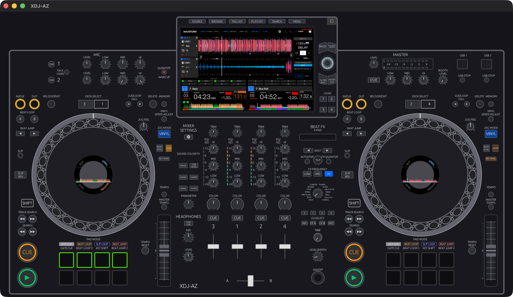

# xdj-az-emu

A developer emulator for the **XDJ-AZ** running
[AZ-MODS](https://github.com/Kyle-Hosman/xdj-az-mods). It runs the deck's own program
on your computer, with the same AZ-MODS core a real deck runs, so you can build and
test Community Mods without a deck on your desk.

<p align="center"></p>

xdj-az-emu is built on [cdj3k-emu](https://github.com/nsaintot/cdj3k-emu), nsaintot's CDJ-3000
emulator: the virtual machine, the boot path and the panel drawing all started there. See
[ATTRIBUTION.md](ATTRIBUTION.md) for what was kept and changed.

- **No firmware in this repository.** You copy the deck's system from your own rooted
  XDJ-AZ once (`tools/az-emu-pull.py`); it never leaves your computer.
- **Everything else is built from source here:** the Linux kernel and its modules, the
  virtual front panel, the shim, an SSH server, QEMU (on macOS) and the AZ-EMU app.
- **Mods are not part of it.** They load from the USB stick (emulated or real) through
  the deck's own AZ-MODS loader, as on a deck. `tools/az-mods-fetch.py` puts the
  published AZ-MODS set on the USB, checked against its release signature;
  `tools/az-push-mod.py` loads your own build in one command.

Supports XDJ-AZ firmware 2.00+ on Mac (Apple Silicon) and Windows.

## Quick start (Mac)

With the tools in [Requirements](docs/requirements.md) installed and SSH access to your
deck turned on ([guide, step 2](docs/guide.md#2-copy-the-system-from-your-deck)):

```sh
git clone https://github.com/Kyle-Hosman/xdj-az-emu.git
cd xdj-az-emu
python3 tools/az-emu-pull.py --host DECK-IP --key ~/.azmods/ssh/xdjaz_ecdsa   # 1. copy the system from your deck
./build.sh                        # 2. kernel, tools, boot image
qemu/build.sh                     #    QEMU (once)
tools/build-app.sh                #    AZ-EMU.app (once)
open AZ-EMU.app                   # 3. run
python3 tools/az-mods-fetch.py    # 4. put AZ-MODS on the emulated stick
python3 tools/az-push-mod.py path/to/my-mod/   # 5. load your mod
```

On Windows, follow [Windows](docs/windows.md).

## Documentation

- [The guide](docs/guide.md): install, pull, build, run, load your mod
- [Requirements](docs/requirements.md): what each kind of computer needs
- [Windows](docs/windows.md): step-by-step setup on a Windows PC
- [Controls](docs/controls.md): the app, `tools/az-drive.py`, the other tools
- [Troubleshooting](docs/troubleshooting.md)
- [How it works](docs/how-it-works.md)

## Related repositories

- [xdj-az-mods](https://github.com/Kyle-Hosman/xdj-az-mods): AZ-MODS itself: install, features, releases
- [az-mods-sdk](https://github.com/Kyle-Hosman/az-mods-sdk): write a community mod: the header, the build container, the developer guide
- [az-mods-examples](https://github.com/Kyle-Hosman/az-mods-examples): first-party example mods built with the SDK
- [az-mods-index](https://github.com/Kyle-Hosman/az-mods-index): the Mod Index, the shared list of mod repositories every deck shows

## License

GPL-3.0-only for this project's code ([LICENSE](LICENSE)); the kernel modules are
GPL-2.0-only, except the module files kept from cdj3k-emu, which stay
GPL-2.0-or-later as upstream; the kernel and QEMU patches are GPL-2.0-or-later; and
the other files kept from cdj3k-emu, with the panel drawing code ported from it, stay
MIT OR Apache-2.0. Each file's SPDX header says which.
This project started as a fork of [cdj3k-emu](https://github.com/nsaintot/cdj3k-emu);
see [ATTRIBUTION.md](ATTRIBUTION.md) and [NOTICE](NOTICE).

<p align="center"><sub>Not affiliated with AlphaTheta, Pioneer DJ or rekordbox; trademarks belong to their owners.</sub></p>
